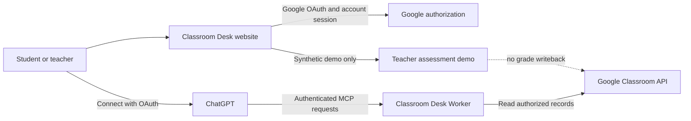

<div align="center">
  
  <h1>Classroom Desk</h1>
  <p><strong>Your Google Classroom. Smarter with ChatGPT.</strong></p>
  <p>A free, open-source Google Classroom assistant that brings authorized course context into ChatGPT for students and teachers.</p>
  <p>
    <a href="https://classroom.jarvis404.com"><strong>Live website</strong></a> ·
    <a href="https://github.com/Fawzankhan-404/Classroom-Desk"><strong>GitHub repository</strong></a> ·
    <a href="docs/GETTING_STARTED.md">Getting started</a> ·
    <a href="docs/OPEN_SOURCE_ARCHITECTURE.md">Architecture</a> ·
    <a href="docs/CHATGPT_CONNECTION_GUIDE.md">Connect ChatGPT</a>
  </p>
  <p>
    
    
    
    
    
  </p>
</div>

---

## About

Classroom Desk connects a Google account to ChatGPT through Google OAuth and the Model Context Protocol (MCP). ChatGPT can then ask for supported Classroom information on the signed-in user's behalf. Google authorization and course roles continue to determine which records are available.

The project has two dashboard preferences. **Student** is the default. **Teacher** opens an explicitly synthetic assessment demonstration in this release candidate. Choosing Teacher does not grant a Google teacher role or expose real class rosters. Real gradebook writeback is disabled.

The public repository documents the current open-source implementation. Website functionality may be released separately from source changes.

## Product at a glance

| Experience | Available in this source | Boundary |
|---|---|---|
| Student and Teacher selection | Yes | Preference is stored per Classroom Desk account. Student is the default. |
| Classroom information in ChatGPT | Yes, for the Google account's authorized records | Classroom data is read-only; Google permissions and API role checks apply. |
| Save a finished assignment PDF | Available with explicit confirmation in the supported Student workflow | Creates a file in the connected student's Drive. It does not submit work to Classroom. |
| Teacher dashboard | Yes | Currently shows a synthetic assessment workspace. |
| Assessment rubric and six submissions | Demo only | Evidence is checked against synthetic responses; missing or unreadable work remains unscored. |
| Teacher approval | Demo only | Approval is local to the synthetic demo. It never writes a Google Classroom grade. |
| Live teacher rosters and submissions | Not included in this demo | Requires verified Google teacher authorization and separate implementation. |
| Paid plans and new checkout | Disabled in this candidate | Existing subscription records are preserved; active recurring subscriptions need account-owner cancellation. |

## Student experience

The account dashboard shows sign-in and Google connection status. In ChatGPT, supported tools can list the connected account's courses, coursework, announcements, topics, upcoming deadlines, recent activity, and the student's own submission state. Results come from Google Classroom and are limited to the authorization granted by the user.

Classroom assignments and grades are not changed by the MCP tools. In the supported Student workflow, saving a finished PDF creates a file in the connected student's Drive only after the student explicitly asks for the upload. The tool returns a manual Classroom handoff; the student must attach the file and turn it in. Attachment reading is separately scoped and requires explicit authorization where supported.

## Teacher experience

The Teacher dashboard is a synthetic assessment demonstration. It includes a versioned rubric, six clearly identified sample submissions, evidence-backed draft marks, review flags, and local demo approval. The sample set contains missing and unreadable submissions; those stay unscored and cannot be approved.

The dashboard selector changes the preferred experience only. It does not grant teacher permissions. The current demonstration does not read real teacher rosters or submissions and has no Classroom gradebook writeback.

## How it works



The server validates OAuth state and PKCE, stores tokens using the configured encrypted authorization store, and evaluates each MCP request against its authenticated account. Product access does not replace Google authorization.

## Connect ChatGPT

Use the single customer-facing website:

1. Visit [Classroom Desk](https://classroom.jarvis404.com/) and sign in with Google. The `/start` onboarding route is part of this candidate and becomes available after its release.
2. Choose Student or Teacher. Student is the default; the choice does not change Google permissions.
3. Connect Classroom Desk from ChatGPT and approve the Google scopes shown by Google.
4. Return to ChatGPT and ask for your courses.

See the [connection guide](docs/CHATGPT_CONNECTION_GUIDE.md). Custom MCP availability depends on the ChatGPT workspace and plan. The service does not claim that ChatGPT exposes a stable user identity outside its authenticated OAuth grant.

## Technology

- TypeScript and Node.js 20+
- Cloudflare Workers and D1 for the Worker deployment path
- Google OAuth and Google Classroom APIs
- Model Context Protocol SDK with Streamable HTTP and local stdio transports
- Express for the local and Worker-compatible application routing layer
- Vitest, PGlite, and Wrangler for tests and local validation

The exact deployed production source is not established by the available Worker metadata. This repository should be treated as the current candidate source, not as a proven copy of production Worker version 22.

## Local development

Requirements: Node.js 20 or newer and npm.

```bash
npm ci
npm run check
npm test
npm run build
npm run build:worker
```

Tests use synthetic records and local databases. They do not validate a live Google account or ChatGPT connector. `npm run build:worker` is a Wrangler dry run; it does not deploy.

For local OAuth, configure a separate Google OAuth client and use loopback callback URLs. Never use production credentials in local development. See [getting started](docs/GETTING_STARTED.md) and [self-hosting](docs/SELF_HOSTING.md).

## Configuration

Copy `.env.example` to an ignored `.env` file and supply only values for the environment you intend to run. Do not commit `.env`, `.dev.vars`, OAuth client JSON, database backups, or secret-manager exports.

| Variable | Purpose |
|---|---|
| `PUBLIC_APP_ORIGIN` | This installation's HTTPS origin; use loopback for local work. |
| `MCP_RESOURCE_URL` | MCP resource URL for this installation. |
| `GOOGLE_OAUTH_CLIENT_ID` | OAuth Web client ID configured for this installation. |
| `GOOGLE_OAUTH_CLIENT_SECRET` | OAuth Web client secret, provided through a secret manager. |
| `PUBLIC_AUTH_STORE` | Authorization storage adapter (`memory`, `postgres`, or deployment-specific D1). |
| `DATABASE_URL` | Local PostgreSQL connection when that adapter is used. |
| `PUBLIC_AUTH_ENCRYPTION_KEY_B64` | Base64-encoded 32-byte key for the authorization store. Generate and store it securely. |
| `PUBLIC_OPERATOR_NAME`, `PUBLIC_SUPPORT_EMAIL` | Installation operator and support contact. |
| PUBLIC_STAGE_WIDE_VIDEO_URL, PUBLIC_STAGE_WIDE_POSTER_URL | Optional HTTPS CloudFront homepage media for wide screens. |
| PUBLIC_STAGE_NARROW_VIDEO_URL, PUBLIC_STAGE_NARROW_POSTER_URL | Optional HTTPS CloudFront homepage media for narrow screens. |

See [.env.example](.env.example) for the placeholder list. Never place actual secrets in that file.

## Security and privacy

- Google sign-in and Classroom authorization are separate from the Student/Teacher dashboard preference.
- Teacher selection does not grant teacher role or access to real rosters.
- Classroom MCP actions are read-only and limited to the authenticated Google authorization and supported API methods. The separate PDF save action can create a Drive file only after explicit student confirmation.
- OAuth state, PKCE, same-origin checks, bounded request schemas, and account isolation are tested in the source suite.
- Demo submissions and marks are synthetic. Demo approval is not a grade.
- No gradebook writeback is implemented in the demonstration.
- A self-hosted deployment must validate database compatibility, encryption-key access, OAuth callbacks, and rollback procedures before receiving user traffic.

Report vulnerabilities privately using the process in [SECURITY.md](SECURITY.md).

## CodeCraft 2026

Classroom Desk was an existing application before CodeCraft 2026. The Student/Teacher selector and synthetic assessment implementation were present in the development tree before this free-product work. Event-time changes are recorded in [CODECRAFT_2026_CONTRIBUTIONS.md](CODECRAFT_2026_CONTRIBUTIONS.md), with uncertain timestamps labeled rather than inferred from Git history.

The demonstrated assessment workflow uses synthetic responses. No claim is made that an AI model graded real student work or that grades were written to Google Classroom.

## Contributing

Read [CONTRIBUTING.md](CONTRIBUTING.md), run the checks above, and include focused tests with behavioral changes. Do not submit real student data, credentials, OAuth tokens, or production database exports.

## License

Classroom Desk project source is licensed under [Apache License 2.0](LICENSE); see [NOTICE](NOTICE.md) for brand and third-party material boundaries. Third-party packages retain their own licenses.

## Developer

**Mohammed Fawzan Khan**

Classroom Desk is an independent project and is not affiliated with or endorsed by Google or OpenAI.
