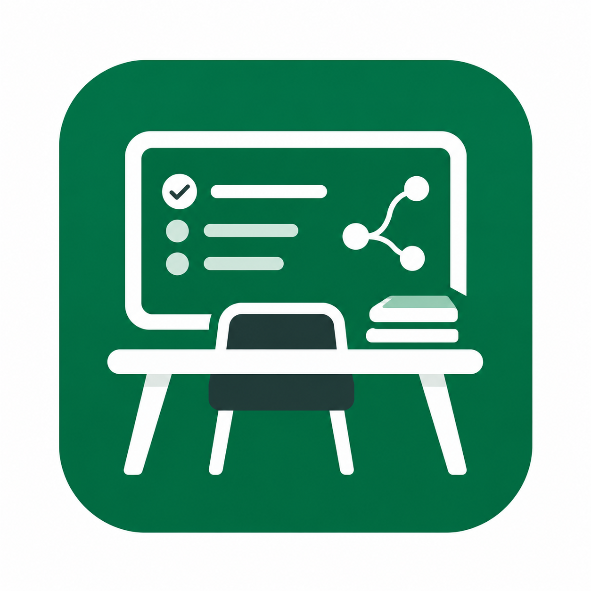
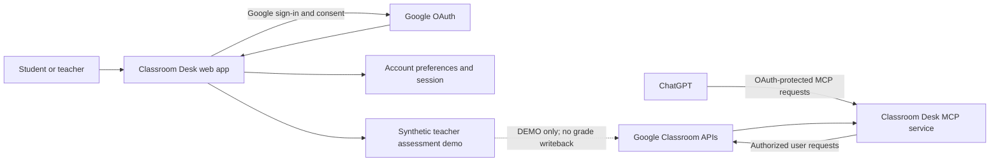

<div align="center">
  

  <h1>Classroom Desk</h1>
  <p><strong>Your Google Classroom. Smarter with ChatGPT.</strong></p>
  <p>A free, open-source assistant that brings your authorized Google Classroom context into ChatGPT.</p>

  <p>
    <a href="https://classroom.jarvis404.com"><strong>Open Classroom Desk</strong></a> &nbsp;·&nbsp;
    <a href="https://github.com/Fawzankhan-404/Classroom-Desk"><strong>GitHub repository</strong></a> &nbsp;·&nbsp;
    <a href="docs/GETTING_STARTED.md">Get started</a> &nbsp;·&nbsp;
    <a href="docs/CHATGPT_CONNECTION_GUIDE.md">Connect ChatGPT</a> &nbsp;·&nbsp;
    <a href="docs/OPEN_SOURCE_ARCHITECTURE.md">Architecture</a>
  </p>

  <p>
    <a href="LICENSE"></a>
    
    
    
  </p>
</div>

---

## Overview

Classroom Desk connects a Google account to ChatGPT through Google OAuth and the [Model Context Protocol](https://modelcontextprotocol.io/). It helps students find course information and stay oriented around classwork, while keeping access tied to the Google account and permissions they authorize.

The repository contains a TypeScript application with a web experience, MCP tools, and local development support. The hosted service and this source repository are separate release artifacts; a local build does not establish which source revision is running on the hosted service.

## Product capabilities

| Experience | What it includes | Data and action boundary |
|---|---|---|
| **Student** | Supported course, coursework, deadline, announcement, material, and personal submission information. | Results depend on the connected Google account, its permissions, and course membership. A Drive-file action requires an explicit request and does not submit work to Classroom. |
| **Teacher dashboard** | A rubric and six sample responses with evidence-based draft marks, review flags, and local demo approval. | The assessment workspace uses synthetic records labeled **DEMO**. Demo approval never changes a real grade. |
| **Teacher Classroom access** | Separate teacher operations are available only when the account has the required Google authorization and Google confirms the relevant course role. | Choosing Teacher changes the dashboard preference; it does not grant teacher access. Availability depends on deployment configuration and consent. |
| **Gradebook** | No automatic grade publication. | Google Classroom gradebook writeback is disabled. |

The assessment model is a demonstration workflow. It does not claim that an AI model has graded real student submissions.

## How it works



Google authorization, Classroom permissions, and the Student/Teacher dashboard preference are separate controls. The preference is not an authorization boundary.

## Get started

### Use the hosted service

1. Visit [classroom.jarvis404.com](https://classroom.jarvis404.com/) and sign in with Google.
2. Choose Student or Teacher. Student is the default; the choice can be changed later.
3. Connect Google Classroom and review the permissions shown by Google.
4. Connect the canonical MCP endpoint, `https://classroom.jarvis404.com/mcp`, to ChatGPT where custom MCP connections are available.
5. Ask ChatGPT about courses and work available to the connected Google account.

See the [ChatGPT connection guide](docs/CHATGPT_CONNECTION_GUIDE.md) for setup and troubleshooting.

### Run locally

**Requirements:** Node.js 20 or later and npm.

```bash
git clone https://github.com/Fawzankhan-404/Classroom-Desk.git
cd Classroom-Desk
npm ci
```

Copy `.env.example` to `.env` and configure a dedicated development OAuth client and local data store. Keep credentials in the ignored `.env` file or a secret manager. Never use production credentials or production data for local development.

```bash
npm run check
npm test
npm run build
npm run start:http
```

Automated tests use synthetic data and do not require Google credentials. `npm run build:worker` performs a Wrangler dry run; it does not deploy. Before self-hosting, review the [self-hosting guide](docs/SELF_HOSTING.md) and every binding in the sanitized [`wrangler.example.jsonc`](wrangler.example.jsonc).

## Technology

- **TypeScript** with Node.js 20+ for local development
- **Model Context Protocol SDK** for authenticated ChatGPT tool access
- **Google OAuth** and Google Classroom APIs for user-authorized data
- **Cloudflare Workers and D1** for the Worker deployment path
- **Express** and PostgreSQL-compatible storage for supported local/server configurations
- **Vitest** for automated tests

Deployment options have different bindings and storage requirements. Use only the configuration intended for the environment you operate.

## Security and privacy

- Google sign-in and Classroom authorization are explicit and separate.
- Classroom data access is scoped to the connected account and the permissions Google grants.
- Selecting Teacher does not grant a Google role, scope, or course membership.
- Teacher-only requests require server-side authorization and Google-confirmed course access.
- Synthetic assessment records stay separate from real submissions; approval is local to the demo.
- No Google Classroom gradebook writeback is available.
- Never commit `.env`, `.dev.vars`, OAuth client files, database backups, tokens, cookies, secret-manager exports, or student records.

For vulnerability reports, follow the private process in [SECURITY.md](SECURITY.md). Review the [notice](NOTICE.md) for project-brand and third-party material boundaries.

## Contributing

Contributions are welcome. Start with [`CONTRIBUTING.md`](CONTRIBUTING.md), use synthetic fixtures, and include focused tests for behavior changes. Do not include private Classroom content, production database exports, credentials, or OAuth tokens in issues or pull requests.

## License and attribution

Project source and documentation are available under the [Apache License 2.0](LICENSE). Third-party dependencies and materials retain their own licenses. The Classroom Desk name, logo, hosted service, and third-party marks are not granted under the source license; see [`NOTICE.md`](NOTICE.md).

Created by **Mohammed Fawzan Khan**. Classroom Desk is an independent project and is not affiliated with or endorsed by Google or OpenAI.
